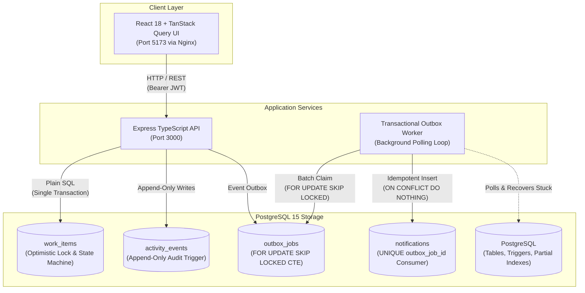

# PressureDesk: Operations Under Pressure

An internal operations management web application built for high-pressure incident response, payment disputes, compliance audits, and task triage. Teams create, assign, track, and resolve operational work items with strictly enforced server-side workflow state machines, atomic claims, optimistic concurrency control, and transactional outbox event delivery.

---

## Prerequisites

- **Docker Desktop** (Engine 24+, Compose v2)
- **Node.js 20+** and **npm 10+** (for running local tests and scripts)

---

## One-Command Setup

### 1. Launch All Services via Docker Compose
Builds and starts PostgreSQL, runs database migrations automatically, launches the Express API, starts the transactional outbox worker, and serves the React frontend via Nginx:

```bash
docker compose up --build
```

- **Frontend Application**: [http://localhost:5173](http://localhost:5173)
- **Backend API**: [http://localhost:3000](http://localhost:3000)
- **Health Check**: [http://localhost:3000/health](http://localhost:3000/health)

### 2. Seed Initial Operational Data
In a separate terminal, populate users, operational teams, memberships, and initial work items:

```bash
npm run seed
```

---

## Demo Accounts

All seeded accounts use the default password: `Password123!`

| Role / Scope | Email | Primary Responsibilities |
| :--- | :--- | :--- |
| **Admin & Lead** | `alice@pressuredesk.io` | Admin in Core Infra, Lead in Incident Response, Member in Payments |
| **Lead (Payments)** | `bob@pressuredesk.io` | Lead in Payments & Billing, Member in Incident Response |
| **Lead (Compliance)**| `charlie@pressuredesk.io`| Lead in Compliance & Risk, Member in Core Infra |
| **Viewer (Read-Only)**| `ivan@pressuredesk.io` | Viewer across operational teams (can view and comment) |

---

## Running Tests

Execute the complete test suite (unit, concurrency, and database integration tests) with a single command:

```bash
npm test
```

---

## System Architecture



---

## Known Limitations

1. **Single-Lead Four-Eyes Deadlock**:
   - The four-eyes principle forbids the creator of an item from approving their own item (`req.user.id !== created_by_id`). If an operational team has exactly one Lead/Admin and that Lead creates an incident or payment ticket, that ticket cannot be approved by that team. A second Lead or system Admin must intervene.
2. **No Refresh Tokens**:
   - Authentication issues signed JWT access tokens with a fixed 1-hour expiry. To maintain security, memberships are loaded fresh from the database on every request, but token renewal currently requires re-authenticating.
3. **Polling vs WebSockets**:
   - The frontend synchronizes dashboard queues via TanStack Query window refocusing and polling intervals rather than full-duplex WebSockets or Server-Sent Events (SSE).
4. **No Rate Limiting**:
   - API endpoints do not currently enforce IP or token bucket rate limiting headers (`X-RateLimit-*`).

---

## Next Week I Would...

- [ ] Implement short-lived access tokens with HTTP-only rotating refresh tokens in the database.
- [ ] Add PostgreSQL `LISTEN / NOTIFY` triggers to wake the outbox worker immediately on insert instead of relying exclusively on the 1-second polling timer.
- [ ] Implement Server-Sent Events (SSE) or WebSockets on `/items/stream` for live push updates across operator dashboards.
- [ ] Introduce token-bucket rate limiting middleware backed by PostgreSQL advisory locks or a memory store on `/auth/login` and `/items`.
- [ ] Add CSV/JSON audit export functionality for the append-only `activity_events` ledger for compliance reporting.
