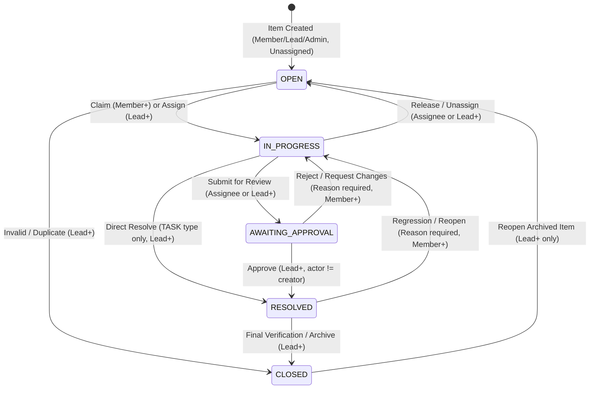

# PressureDesk: Operations Under Pressure - System Architecture & Technical Design

---

### 1. Open questions and assumptions

| Question | My assumption | Why | Would ask a PM first? (Y/N) |
| :--- | :--- | :--- | :--- |
| **Who can create items?** | Any user with role `Member`, `Lead`, or `Admin` in the target team. `Viewer` cannot create items. Items always start in `status = 'OPEN'` with `assignee_id = NULL`. | Viewers are read-only auditors/stakeholders. Operational items should only originate from active contributors or team leaders. | **Y** |
| **Who can claim items?** | Any `Member`, `Lead`, or `Admin` of the item's assigned team can claim an item that is currently in `status = 'OPEN'` and has `assignee_id IS NULL`. Claiming sets `assignee_id = req.user.id` and transitions status to `IN_PROGRESS`. | Keeps task dispatch self-service and decentralized while guaranteeing that the claiming user belongs to the operational team. | **Y** |
| **Can a Viewer comment?** | Yes, `Viewer` can post comments, but cannot change state, assignee, priority, or metadata. | External stakeholders, QA, or auditors often need to add clarifying context or customer feedback without modifying operational workflow states. | **Y** |
| **What happens on conflict?** | Optimistic concurrency failure returns `409 Conflict` with error code `STALE_VERSION` and the full, current representation of the work item. | Allows client UI to show a clean diff or notification ("Item modified by another user. Review latest changes") without losing updates. | **N** |
| **Can items move backwards (e.g. reopen)?** | Yes, but strictly controlled: `Resolved -> In Progress` can be executed by `Member`, `Lead`, or `Admin` (with reason). `Closed -> Open` (reopen) is strictly restricted to `Lead` and `Admin`. | Real-world fixes fail validation and must resume work; however, reopening archived/closed items impacts SLA reporting and requires team lead governance. | **Y** |
| **Who can reassign?** | The current assignee can hand off to another member of the same team. `Lead` and `Admin` can assign, reassign, or unassign any item within their team. Members cannot reassign tickets assigned to others. | Prevents operational chaos and task-dumping while providing leads full dispatch authority. | **Y** |
| **What does "urgent" mean?** | Exactly `priority = 'URGENT' AND assignee_id IS NULL AND status = 'OPEN'`. | Consistent, deterministic condition across both assumptions and dashboard queries, directly backed by a Postgres partial index. | **Y** |
| **Can a user be in multiple teams?** | Yes. Users have a Many-to-Many relationship with Teams via a `memberships` table, carrying a specific role per team (`Viewer`, `Member`, `Lead`, `Admin`). | Mirrors real-world cross-functional operations (e.g., Lead of Incident Response, Viewer on Payments). | **N** |
| **Soft delete or not?** | No soft delete column (`deleted_at`). Items cancelled or deemed invalid move to `Closed` status with an activity reason code. | Operational and regulatory compliance requires an immutable audit history. Physical deletion breaks relational integrity of activity logs. | **Y** |
| **Due date rules?** | `due_date` is an optional UTC timestamp. When set or updated, it must be $\ge \text{NOW()}$ (cannot set past deadlines), unless modified by a `Lead` or `Admin` for post-incident backfilling. | Prevents erroneous deadline entry while preserving administrative flexibility. | **Y** |
| **Can an author approve their own item?** | No. Four-eyes principle: The user transitioning an item from `Awaiting Approval -> Resolved` must be a `Lead` or `Admin` of the team **AND** `user_id != created_by_id`. | Guarantees genuine operational sign-off and prevents circumvention of compliance controls. *(See Known Limitations for single-lead team deadlock).* | **Y** |
| **Direct resolution allowed?** | Only allowed for `type = 'TASK'` by a `Lead` or `Admin`. All other item types (`INCIDENT`, `CUSTOMER_ISSUE`, `PAYMENT`, `COMPLIANCE`) MUST transition through `AWAITING_APPROVAL`. | Prevents approval bypass for critical financial and operational risk items. | **Y** |

---

### 2. State machine



#### State Transition Matrix

| From | To | Allowed Roles | Extra Conditions |
| :--- | :--- | :--- | :--- |
| `[*] (None)` | `OPEN` | `Member`, `Lead`, `Admin` | Initial creation. Always created with `assignee_id = NULL` and `status = 'OPEN'`. |
| `OPEN` | `IN_PROGRESS` | `Member`, `Lead`, `Admin` | Claimed by user (`assignee_id = req.user.id`) or explicitly assigned by `Lead`/`Admin`. Requires `assignee_id IS NOT NULL`. |
| `OPEN` | `CLOSED` | `Lead`, `Admin` | For duplicates, invalid tickets, or cancelled operations. Audit comment required. |
| `IN_PROGRESS` | `OPEN` | `Member`, `Lead`, `Admin` | Current assignee relinquishing ticket, or `Lead`/`Admin` unassigning. Sets `assignee_id = NULL`. |
| `IN_PROGRESS` | `AWAITING_APPROVAL` | `Member`, `Lead`, `Admin` | Current assignee or `Lead`/`Admin`. Mandatory path for `INCIDENT`, `PAYMENT`, `COMPLIANCE`, `CUSTOMER_ISSUE`. |
| `IN_PROGRESS` | `RESOLVED` | `Lead`, `Admin` | **Strict Condition:** Allowed **ONLY** if `type = 'TASK'`. High-risk types cannot bypass approval. |
| `AWAITING_APPROVAL` | `RESOLVED` | `Lead`, `Admin` | **Four-eyes principle:** Transition actor `req.user.id != created_by_id`. |
| `AWAITING_APPROVAL` | `IN_PROGRESS` | `Member`, `Lead`, `Admin` | Rejection or rework requested. Mandatory feedback reason in request payload. |
| `RESOLVED` | `CLOSED` | `Lead`, `Admin` | Final sign-off. Work item permanently archived. |
| `RESOLVED` | `IN_PROGRESS` | `Member`, `Lead`, `Admin` | Regression discovered during verification. Mandatory reason in payload. |
| `CLOSED` | `OPEN` | `Lead`, `Admin` | Reopening an archived ticket requires elevated team privileges. |

---

### 3. Role $\times$ action permission matrix

| Action | Viewer | Member | Lead | Admin |
| :--- | :---: | :---: | :---: | :---: |
| **View item, comments & activity log** | ✅ | ✅ | ✅ | ✅ |
| **Create new work item** | ❌ | ✅ | ✅ | ✅ |
| **Edit basic metadata (title, description, due_date)** | ❌ | ✅ *(assignee only)* | ✅ | ✅ |
| **Change priority (`PATCH /items/:id`)** | ❌ | ❌ | ✅ | ✅ |
| **Claim unassigned item (`POST /items/:id/claim`)** | ❌ | ✅ | ✅ | ✅ |
| **Reassign item: self $\to$ other (`POST /items/:id/assign`)** | ❌ | ✅ *(assignee only)* | ✅ | ✅ |
| **Reassign item: other $\to$ other / unassign (`POST /items/:id/assign`)** | ❌ | ❌ | ✅ | ✅ |
| **Post comment (`POST /items/:id/comments`)** | ✅ | ✅ | ✅ | ✅ |
| **Transition: Open $\to$ In Progress** | ❌ | ✅ | ✅ | ✅ |
| **Transition: In Progress $\to$ Awaiting Approval** | ❌ | ✅ *(assignee only)* | ✅ | ✅ |
| **Transition: In Progress $\to$ Resolved (Direct)** | ❌ | ❌ | ✅ *(TASK only)* | ✅ *(TASK only)* |
| **Transition: Awaiting Approval $\to$ Resolved (Approve)** | ❌ | ❌ | ✅ *(if $\ne$ creator)* | ✅ *(if $\ne$ creator)* |
| **Transition: Awaiting Approval $\to$ In Progress (Reject)** | ❌ | ✅ | ✅ | ✅ |
| **Transition: Resolved $\to$ Closed** | ❌ | ❌ | ✅ | ✅ |
| **Transition: Closed $\to$ Open (Reopen)** | ❌ | ❌ | ✅ | ✅ |

#### Handling Users Not in the Item's Team: HTTP 404 vs 403

* **For Item-Specific Read & Mutation (`GET /items/:id`, `PATCH /items/:id`, `POST /items/:id/*`)**:
  * **Response:** If the item ID does not exist in any team the user belongs to, return **`404 Not Found`**.
  * **Justification:** Prevents **resource existence enumeration** and information leakage across team boundaries. A rogue user cannot probe UUIDs to determine if an incident or compliance issue exists.
* **For Team-Level Operations (e.g. `GET /items?team_id=...`, `POST /items`)**:
  * **Response:** If the user is not a member of the requested `team_id`, return **`403 Forbidden`** with `{ "error": { "code": "NOT_TEAM_MEMBER", "message": "You are not a member of this team." } }`.
* **For Insufficient Role Within Team**:
  * **Response:** Return **`403 Forbidden`** with `{ "error": { "code": "INSUFFICIENT_TEAM_ROLE", "message": "This action requires Lead or Admin role." } }`.

---

### 4. Data model

```sql
-- PostgreSQL 15+ Schema Definition

CREATE EXTENSION IF NOT EXISTS "pgcrypto";

-- ENUM TYPES
CREATE TYPE user_team_role AS ENUM ('VIEWER', 'MEMBER', 'LEAD', 'ADMIN');
CREATE TYPE work_item_type AS ENUM ('INCIDENT', 'CUSTOMER_ISSUE', 'PAYMENT', 'COMPLIANCE', 'TASK');
CREATE TYPE work_item_priority AS ENUM ('LOW', 'MEDIUM', 'HIGH', 'URGENT');
CREATE TYPE work_item_status AS ENUM ('OPEN', 'IN_PROGRESS', 'AWAITING_APPROVAL', 'RESOLVED', 'CLOSED');
CREATE TYPE outbox_status AS ENUM ('PENDING', 'PROCESSING', 'COMPLETED', 'DEAD_LETTER');

-- 1. USERS
CREATE TABLE users (
    id UUID PRIMARY KEY DEFAULT gen_random_uuid(),
    email VARCHAR(255) NOT NULL UNIQUE,
    password_hash VARCHAR(255) NOT NULL,
    full_name VARCHAR(150) NOT NULL,
    created_at TIMESTAMPTZ NOT NULL DEFAULT NOW(),
    updated_at TIMESTAMPTZ NOT NULL DEFAULT NOW()
);

-- 2. TEAMS
CREATE TABLE teams (
    id UUID PRIMARY KEY DEFAULT gen_random_uuid(),
    name VARCHAR(100) NOT NULL UNIQUE,
    slug VARCHAR(100) NOT NULL UNIQUE,
    created_at TIMESTAMPTZ NOT NULL DEFAULT NOW(),
    updated_at TIMESTAMPTZ NOT NULL DEFAULT NOW()
);

-- 3. MEMBERSHIPS (Many-to-Many Users <-> Teams with role scoping)
CREATE TABLE memberships (
    id UUID PRIMARY KEY DEFAULT gen_random_uuid(),
    user_id UUID NOT NULL REFERENCES users(id) ON DELETE CASCADE,
    team_id UUID NOT NULL REFERENCES teams(id) ON DELETE CASCADE,
    role user_team_role NOT NULL DEFAULT 'VIEWER',
    created_at TIMESTAMPTZ NOT NULL DEFAULT NOW(),
    updated_at TIMESTAMPTZ NOT NULL DEFAULT NOW(),
    CONSTRAINT uq_memberships_user_team UNIQUE (user_id, team_id)
);

-- 4. WORK ITEMS
CREATE TABLE work_items (
    id UUID PRIMARY KEY DEFAULT gen_random_uuid(),
    title VARCHAR(255) NOT NULL,
    description TEXT NOT NULL DEFAULT '',
    type work_item_type NOT NULL,
    priority work_item_priority NOT NULL DEFAULT 'MEDIUM',
    status work_item_status NOT NULL DEFAULT 'OPEN',
    team_id UUID NOT NULL REFERENCES teams(id) ON DELETE RESTRICT,
    assignee_id UUID REFERENCES users(id) ON DELETE SET NULL,
    created_by_id UUID NOT NULL REFERENCES users(id) ON DELETE RESTRICT,
    due_date TIMESTAMPTZ,
    version INT NOT NULL DEFAULT 1,
    tsv tsvector GENERATED ALWAYS AS (
        setweight(to_tsvector('english', coalesce(title, '')), 'A') ||
        setweight(to_tsvector('english', coalesce(description, '')), 'B')
    ) STORED,
    created_at TIMESTAMPTZ NOT NULL DEFAULT NOW(),
    updated_at TIMESTAMPTZ NOT NULL DEFAULT NOW(),
    CONSTRAINT ck_title_non_empty CHECK (length(trim(title)) > 0),
    CONSTRAINT ck_version_positive CHECK (version > 0)
);

-- 5. ACTIVITY EVENTS (Append-only audit trail)
-- Notice ON DELETE RESTRICT: Work items with audit trails cannot be deleted.
CREATE TABLE activity_events (
    id UUID PRIMARY KEY DEFAULT gen_random_uuid(),
    work_item_id UUID NOT NULL REFERENCES work_items(id) ON DELETE RESTRICT,
    actor_id UUID NOT NULL REFERENCES users(id) ON DELETE RESTRICT,
    event_type VARCHAR(50) NOT NULL, -- 'CREATED', 'CLAIMED', 'ASSIGNED', 'UNASSIGNED', 'STATUS_CHANGE', 'PRIORITY_CHANGE', 'COMMENT_ADDED'
    from_state JSONB,
    to_state JSONB NOT NULL,
    metadata JSONB NOT NULL DEFAULT '{}'::jsonb,
    created_at TIMESTAMPTZ NOT NULL DEFAULT NOW()
);

-- 6. COMMENTS
CREATE TABLE comments (
    id UUID PRIMARY KEY DEFAULT gen_random_uuid(),
    work_item_id UUID NOT NULL REFERENCES work_items(id) ON DELETE CASCADE,
    author_id UUID NOT NULL REFERENCES users(id) ON DELETE RESTRICT,
    body TEXT NOT NULL,
    created_at TIMESTAMPTZ NOT NULL DEFAULT NOW(),
    updated_at TIMESTAMPTZ NOT NULL DEFAULT NOW(),
    CONSTRAINT ck_comment_body_non_empty CHECK (length(trim(body)) > 0)
);

-- 7. IDEMPOTENCY KEYS
CREATE TABLE idempotency_keys (
    key VARCHAR(255) NOT NULL,
    user_id UUID NOT NULL REFERENCES users(id) ON DELETE CASCADE,
    request_method VARCHAR(10) NOT NULL,
    request_path VARCHAR(255) NOT NULL,
    request_params_hash CHAR(64) NOT NULL, -- SHA-256 of canonical JSON payload
    response_code INT NOT NULL,
    response_body JSONB NOT NULL,
    created_at TIMESTAMPTZ NOT NULL DEFAULT NOW(),
    expires_at TIMESTAMPTZ NOT NULL,
    PRIMARY KEY (key, user_id)
);

-- 8. OUTBOX JOBS (Transactional outbox for reliable asynchronous delivery)
CREATE TABLE outbox_jobs (
    id UUID PRIMARY KEY DEFAULT gen_random_uuid(),
    event_type VARCHAR(100) NOT NULL,
    aggregate_type VARCHAR(50) NOT NULL DEFAULT 'WORK_ITEM',
    aggregate_id UUID NOT NULL,
    payload JSONB NOT NULL,
    status outbox_status NOT NULL DEFAULT 'PENDING',
    attempt INT NOT NULL DEFAULT 0,
    max_attempts INT NOT NULL DEFAULT 5,
    last_error TEXT,
    locked_at TIMESTAMPTZ,
    locked_by VARCHAR(100),
    scheduled_at TIMESTAMPTZ NOT NULL DEFAULT NOW(),
    created_at TIMESTAMPTZ NOT NULL DEFAULT NOW(),
    updated_at TIMESTAMPTZ NOT NULL DEFAULT NOW()
);

-- 9. NOTIFICATIONS (Downstream idempotent consumer table)
CREATE TABLE notifications (
    id UUID PRIMARY KEY DEFAULT gen_random_uuid(),
    outbox_job_id UUID NOT NULL UNIQUE REFERENCES outbox_jobs(id) ON DELETE CASCADE,
    user_id UUID NOT NULL REFERENCES users(id) ON DELETE CASCADE,
    title VARCHAR(255) NOT NULL,
    message TEXT NOT NULL,
    created_at TIMESTAMPTZ NOT NULL DEFAULT NOW()
);
```

#### Enforcing Append-Only on `activity_events` via Trigger

```sql
CREATE OR REPLACE FUNCTION prevent_activity_mutation()
RETURNS TRIGGER AS $$
BEGIN
    RAISE EXCEPTION 'Table activity_events is append-only. UPDATE and DELETE operations are forbidden.'
        USING ERRCODE = 'integrity_constraint_violation';
END;
$$ LANGUAGE plpgsql;

CREATE TRIGGER trg_protect_activity_events
BEFORE UPDATE OR DELETE ON activity_events
FOR EACH ROW
EXECUTE FUNCTION prevent_activity_mutation();
```

> **Note on Test Data Cleanup**: Because `DELETE` triggers an exception on `activity_events`, automated tests clean up test data using `TRUNCATE TABLE work_items, activity_events, comments, outbox_jobs, idempotency_keys CASCADE;` (PostgreSQL triggers defined with `BEFORE UPDATE OR DELETE` do not block `TRUNCATE`).

---

### 5. Indexes

```sql
-- 1. Keyset Pagination Base Index (Team + Cursor)
-- Serves: GET /items?team_id=... with keyset pagination
CREATE INDEX idx_work_items_team_pagination 
ON work_items (team_id, created_at DESC, id DESC);

-- Exact Query:
-- SELECT id, title, description, type, priority, status, team_id, assignee_id, 
--        created_by_id, due_date, version, created_at::text, updated_at
-- FROM work_items
-- WHERE team_id = $1 
--   AND (created_at, id) < ($cursor_created_at_text::timestamptz, $cursor_id::uuid)
-- ORDER BY created_at DESC, id DESC
-- LIMIT $limit;


-- 2. Team + Status Keyset Pagination Index
-- Serves: Filtered views (e.g. all in-progress or closed items for a team)
CREATE INDEX idx_work_items_team_status 
ON work_items (team_id, status, created_at DESC, id DESC);

-- Exact Query:
-- SELECT * FROM work_items
-- WHERE team_id = $1 AND status = $2
--   AND (created_at, id) < ($cursor_created_at_text::timestamptz, $cursor_id::uuid)
-- ORDER BY created_at DESC, id DESC
-- LIMIT $limit;


-- 3. Partial Index: "Assigned to me" Active Queue
-- Serves: Dashboard view: active items assigned to current user
CREATE INDEX idx_work_items_assigned_active
ON work_items (assignee_id, created_at DESC, id DESC)
WHERE status <> 'CLOSED';

-- Exact Query:
-- SELECT * FROM work_items
-- WHERE assignee_id = $1 AND status <> 'CLOSED'
--   AND (created_at, id) < ($cursor_created_at_text::timestamptz, $cursor_id::uuid)
-- ORDER BY created_at DESC, id DESC
-- LIMIT $limit;


-- 4. Partial Index: "Unassigned urgent" Queue
-- Serves: Dashboard view: unassigned urgent tickets
CREATE INDEX idx_work_items_unassigned_urgent
ON work_items (team_id, created_at DESC, id DESC)
WHERE assignee_id IS NULL 
  AND status = 'OPEN' 
  AND priority = 'URGENT';

-- Exact Query:
-- SELECT * FROM work_items
-- WHERE team_id = $1 AND assignee_id IS NULL AND status = 'OPEN' AND priority = 'URGENT'
--   AND (created_at, id) < ($cursor_created_at_text::timestamptz, $cursor_id::uuid)
-- ORDER BY created_at DESC, id DESC
-- LIMIT $limit;


-- 5. Partial Index: "Awaiting my approval" Queue
-- Serves: Dashboard view: pending approvals for team leads
CREATE INDEX idx_work_items_awaiting_approval
ON work_items (team_id, created_at DESC, id DESC)
WHERE status = 'AWAITING_APPROVAL';

-- Exact Query:
-- SELECT * FROM work_items
-- WHERE team_id = $1 AND status = 'AWAITING_APPROVAL'
--   AND (created_at, id) < ($cursor_created_at_text::timestamptz, $cursor_id::uuid)
-- ORDER BY created_at DESC, id DESC
-- LIMIT $limit;


-- 6. Full-Text Search Index (GIN on tsvector)
-- Serves: Keyword search on items while preserving keyset ordering
CREATE INDEX idx_work_items_tsv 
ON work_items USING GIN (tsv);

-- Exact Query (Search strictly as a filter, sorting by created_at for cursor stability):
-- SELECT id, title, type, priority, status, created_at::text
-- FROM work_items
-- WHERE team_id = $1 
--   AND tsv @@ websearch_to_tsquery('english', $2)
--   AND (created_at, id) < ($cursor_created_at_text::timestamptz, $cursor_id::uuid)
-- ORDER BY created_at DESC, id DESC
-- LIMIT $limit;


-- 7. Outbox Polling Index
-- Serves: Worker polling for ready jobs
CREATE INDEX idx_outbox_jobs_polling
ON outbox_jobs (scheduled_at ASC)
WHERE status = 'PENDING';
```

---

### 6. API design

All endpoints require `Authorization: Bearer <token>` unless marked public. All error responses conform to a consistent error envelope:
`{ "error": { "code": string, "message": string, "details"?: any } }`.

| Method | Path | Auth / Permission | Request Body / Query | Success Status & Body | Error Codes |
| :--- | :--- | :--- | :--- | :--- | :--- |
| `POST` | `/auth/login` | Public | `{ email, password }` | `200 OK`<br>`{ token, user: { id, email, full_name } }` | `400 Bad Request`<br>`401 Invalid Credentials` |
| `GET` | `/items` | Authenticated<br>Team Member | **Query:** `team_id` (required), `status`, `priority`, `assignee_id`, `q`, `cursor` (base64 `created_at_text,id`), `limit` | `200 OK`<br>`{ items: [...], next_cursor: string \| null, has_more: boolean }` | `400 Bad Request`<br>`403 Forbidden` (not in team) |
| `POST` | `/items` | Authenticated<br>`Member+` in team<br>**Header:** `Idempotency-Key` (required) | `{ team_id, title, description, type, priority, due_date? }` *(No assignee allowed at creation)* | `201 Created`<br>`{ item: WorkItem }` | `400 Validation Error`<br>`403 Insufficient Role`<br>`409 Idempotency Conflict` |
| `GET` | `/items/:id` | Authenticated<br>Team Member | None | `200 OK`<br>`{ item: WorkItem }` | `404 Not Found` (item absent or user not in team) |
| `PATCH` | `/items/:id` | Authenticated<br>`Member+` (Assignee, Lead, Admin) | `{ version: number, title?, description?, due_date?, priority? }`<br>*(Changing `priority` requires `Lead` or `Admin` role)* | `200 OK`<br>`{ item: WorkItem }` | `400 Validation Error`<br>`403 Insufficient Role`<br>`404 Not Found`<br>`409 STALE_VERSION` (returns latest item) |
| `POST` | `/items/:id/claim` | Authenticated<br>`Member+` in team | None | `200 OK`<br>`{ item: WorkItem }` | `403 Forbidden`<br>`404 Not Found`<br>`409 ALREADY_CLAIMED` |
| `POST` | `/items/:id/assign` | Authenticated<br>`Member+` (Assignee), `Lead`, `Admin` | `{ version: number, assignee_id: string \| null }`<br>*(Member can only assign self $\to$ teammate; Lead/Admin can assign any or unassign)* | `200 OK`<br>`{ item: WorkItem }` | `400 Validation Error`<br>`403 Insufficient Role`<br>`404 Not Found`<br>`409 STALE_VERSION` |
| `POST` | `/items/:id/transition` | Authenticated<br>Role per state rules | `{ version: number, to_status: string, reason?: string }` | `200 OK`<br>`{ item: WorkItem }` | `400 INVALID_TRANSITION / REASON_REQUIRED`<br>`403 INSUFFICIENT_TEAM_ROLE / CANNOT_APPROVE_OWN_ITEM / APPROVAL_REQUIRES_LEAD_ROLE`<br>`404 NOT_FOUND`<br>`409 STALE_VERSION` |
| `GET` | `/items/:id/activity` | Authenticated<br>Team Member | **Query:** `cursor`, `limit` | `200 OK`<br>`{ events: ActivityEvent[], next_cursor }` | `404 Not Found` |
| `POST` | `/items/:id/comments` | Authenticated<br>Any team role (inc. Viewer) | `{ body: string }` | `201 Created`<br>`{ comment: Comment }` | `400 Empty Body`<br>`404 Not Found` |
| `GET` | `/dashboard/summary` | Authenticated<br>Team Member | **Query:** `team_id` (required) | `200 OK`<br>`{ assigned_to_me_count, unassigned_urgent_count, awaiting_my_approval_count }` | `400 Bad Request`<br>`403 Forbidden` |

#### Standard Error Code to HTTP Status Mapping Table

| Error Code | HTTP Status | Description / Condition |
| :--- | :---: | :--- |
| `IDEMPOTENCY_KEY_REQUIRED` | **400 Bad Request** | Missing or empty `Idempotency-Key` header on `POST /items`. |
| `INVALID_TRANSITION` | **400 Bad Request** | Structurally invalid transition in the state machine (e.g. `OPEN -> RESOLVED`, `OPEN -> OPEN`, `RESOLVED -> OPEN`). |
| `REASON_REQUIRED` | **400 Bad Request** | Mandatory reason missing when rejecting (`AWAITING_APPROVAL -> IN_PROGRESS`), regressing (`RESOLVED -> IN_PROGRESS`), or discarding (`OPEN -> CLOSED`). |
| `VALIDATION_ERROR` | **400 Bad Request** | Missing mandatory payload fields, invalid types, or malformed data. |
| `INSUFFICIENT_TEAM_ROLE` | **403 Forbidden** | User is an active member of the target team, but their role is too low for the attempted action. |
| `CANNOT_APPROVE_OWN_ITEM` | **403 Forbidden** | Four-eyes compliance violation: item creator cannot approve their own item (`req.user.id === item.created_by_id`). |
| `APPROVAL_REQUIRES_LEAD_ROLE`| **403 Forbidden** | Attempted approval (`AWAITING_APPROVAL -> RESOLVED`) by a user with `Member` or `Viewer` role. |
| `NOT_TEAM_MEMBER` | **403 Forbidden** | Attempting team-scoped queries or creation (`GET /items?team_id=...`, `POST /items`) for a team the user does not belong to. |
| `NOT_FOUND` | **404 Not Found** | Work item does not exist, or exists in a team the user is NOT a member of (prevents resource enumeration). |
| `STALE_VERSION` | **409 Conflict** | Optimistic concurrency conflict: submitted version does not match current version in DB (returns latest item in `details.latest_item`). |
| `ALREADY_CLAIMED` | **409 Conflict** | Atomic claim conflict: item is already claimed by another user or is no longer in `OPEN` status. |
| `IDEMPOTENCY_PAYLOAD_MISMATCH`| **422 Unprocessable** | Request submitted with an existing idempotency key, but payload hash differs from original request. |
| `DATABASE_UNAVAILABLE` | **503 Service Unavail**| PostgreSQL pool or socket connection failed. |

---

### 7. Concurrency and failure plan

#### 1. Atomic Claim (Strict Invariant & Re-read on 0 Rows)

* **Invariant**: An item can only be claimed if `status = 'OPEN'` and `assignee_id IS NULL`.
* **Single-Transaction Execution**:
  ```ts
  await client.query('BEGIN');
  const res = await client.query(
    `UPDATE work_items
     SET assignee_id = $1,
         status = 'IN_PROGRESS',
         version = version + 1,
         updated_at = NOW()
     WHERE id = $2 
       AND status = 'OPEN' 
       AND assignee_id IS NULL
     RETURNING *;`,
    [userId, itemId]
  );

  if (res.rowCount === 0) {
    // Determine whether 404 or 409
    const check = await client.query('SELECT id, status, assignee_id FROM work_items WHERE id = $1', [itemId]);
    await client.query('ROLLBACK');
    if (check.rowCount === 0) {
      return res.status(404).json({ error: { code: 'NOT_FOUND', message: 'Work item not found' } });
    }
    return res.status(409).json({ error: { code: 'ALREADY_CLAIMED', message: 'Item already claimed or not open' } });
  }

  const updatedItem = res.rows[0];
  // Write activity event in SAME transaction
  await client.query(
    `INSERT INTO activity_events (work_item_id, actor_id, event_type, from_state, to_state)
     VALUES ($1, $2, 'CLAIMED', $3, $4);`,
    [itemId, userId, JSON.stringify({ status: 'OPEN', assignee_id: null }), JSON.stringify({ status: 'IN_PROGRESS', assignee_id: userId })]
  );

  // Write outbox job in SAME transaction
  await client.query(
    `INSERT INTO outbox_jobs (event_type, aggregate_id, payload)
     VALUES ('WORK_ITEM_CLAIMED', $1, $2);`,
    [itemId, JSON.stringify(updatedItem)]
  );

  await client.query('COMMIT');
  ```
* **Failure Outcome**: Concurrent claimer receives `409 Conflict` (`ALREADY_CLAIMED`).

#### 2. Idempotency Keys (Single-Transaction Safety)

* **Single-Transaction Invariant**: Key insertion, item creation, activity write, outbox write, and stored response update all execute in the exact same database transaction.
* **Atomic Pipeline**: Key insert, item creation, activity write, outbox write, and stored response update happen in the **exact same database transaction**.
* **Flow**:
  ```ts
  const client = await pool.connect();
  try {
    await client.query('BEGIN');
    
    // Attempt inserting the idempotency key with target response pre-calculated or write at end
    const paramsHash = crypto.createHash('sha256').update(JSON.stringify(req.body)).digest('hex');
    
    // Check if key exists
    const existing = await client.query(
      `SELECT response_code, response_body, request_params_hash 
       FROM idempotency_keys 
       WHERE key = $1 AND user_id = $2 
       FOR UPDATE;`,
      [idempotencyKey, req.user.id]
    );

    if (existing.rowCount! > 0) {
      await client.query('COMMIT');
      if (existing.rows[0].request_params_hash !== paramsHash) {
        return res.status(422).json({ error: { code: 'IDEMPOTENCY_PAYLOAD_MISMATCH', message: 'Payload differs for this key' } });
      }
      return res.status(existing.rows[0].response_code)
                .set('Idempotency-Replay', 'true')
                .json(existing.rows[0].response_body);
    }

    // Business writes:
    const item = await insertWorkItem(client, ...);
    await insertActivity(client, ...);
    await insertOutbox(client, ...);

    const responseBody = { item };
    await client.query(
      `INSERT INTO idempotency_keys (key, user_id, request_method, request_path, request_params_hash, response_code, response_body, expires_at)
       VALUES ($1, $2, 'POST', '/items', $3, 201, $4, NOW() + INTERVAL '24 hours');`,
      [idempotencyKey, req.user.id, paramsHash, JSON.stringify(responseBody)]
    );

    await client.query('COMMIT');
    return res.status(201).json(responseBody);
  } catch (err) {
    await client.query('ROLLBACK');
    throw err;
  } finally {
    client.release();
  }
  ```
* **Why this is crash-proof**: If the server crashes mid-flight, the transaction rolls back cleanly. No orphaned idempotency key is left behind. A subsequent retry executes cleanly without manual timeout cleanup.

#### 3. Optimistic Locking with Version Column

* **SQL**:
  ```sql
  UPDATE work_items
  SET title = $1, description = $2, due_date = $3, version = version + 1, updated_at = NOW()
  WHERE id = $4 AND version = $5
  RETURNING *;
  ```
* If `rowCount === 0`, query latest item:
  * If item exists $\to$ return `409 Conflict` with `{ error: { code: "STALE_VERSION", details: { latest_item: item } } }`.
  * If item does not exist $\to$ return `404 Not Found`.

#### 4. Cursor Pagination Precision (Microseconds vs Milliseconds)

* **Problem**: PostgreSQL `TIMESTAMPTZ` stores microseconds ($10^{-6}\text{s}$); JS `Date` only stores milliseconds ($10^{-3}\text{s}$). Converting to `Date` truncates precision and skips or duplicates boundary records.
* **Fix**: Encode `created_at::text` directly into the cursor string:
  ```ts
  // In SQL SELECT:
  // SELECT id, created_at::text AS created_at_cursor, ... FROM work_items ...
  const cursor = Buffer.from(`${row.created_at_cursor},${row.id}`).toString('base64');
  
  // In decoding:
  const [createdAtText, id] = Buffer.from(req.query.cursor, 'base64').toString('utf8').split(',');
  // In SQL WHERE clause:
  // WHERE (created_at, id) < ($1::timestamptz, $2::uuid)
  ```

#### 5. Search + Keyset Pagination Compatibility

* **Search + Keyset Pagination Compatibility**: When keyword search `q` is provided, evaluate `tsv @@ websearch_to_tsquery('english', $q)` strictly as a `WHERE` filter condition, and preserve `ORDER BY created_at DESC, id DESC` to guarantee strict keyset determinism.

#### 6. Database and Worker Failure Modes

* **Database Down**: Pool error handlers immediately intercept failures and return `503 Service Unavailable` (`DATABASE_UNAVAILABLE`).
* **Worker Crash Mid-Job**: The job is marked `status = 'PROCESSING'` with a `locked_at` timestamp. A background sweeper running every minute finds orphaned jobs (`status = 'PROCESSING' AND locked_at < NOW() - INTERVAL '5 minutes'`) and resets them to `PENDING`.

---

### 8. Outbox and worker design

#### 1. Outbox Lifecycle & Polling Query (`FOR UPDATE SKIP LOCKED`)

```sql
WITH ready_jobs AS (
    SELECT id
    FROM outbox_jobs
    WHERE status = 'PENDING'
      AND scheduled_at <= NOW()
    ORDER BY scheduled_at ASC
    LIMIT 10
    FOR UPDATE SKIP LOCKED
)
UPDATE outbox_jobs
SET status = 'PROCESSING',
    attempt = attempt + 1,
    locked_at = NOW(),
    locked_by = $1, -- worker identifier: 'worker-node-1:pid-1024'
    updated_at = NOW()
FROM ready_jobs
WHERE outbox_jobs.id = ready_jobs.id
RETURNING outbox_jobs.*;
```

#### 2. Worker Sweeper for Crash Recovery

```sql
-- Runs periodically (every 60 seconds) to unstick jobs from crashed workers
UPDATE outbox_jobs
SET status = 'PENDING',
    locked_at = NULL,
    locked_by = NULL,
    updated_at = NOW()
WHERE status = 'PROCESSING' 
  AND locked_at < NOW() - INTERVAL '5 minutes';
```

#### 3. Backoff Formula with Jitter

$$t_{\text{scheduled}} = \text{NOW}() + \min(300\text{s}, 2 \times 2^{\text{attempt}-1}\text{s}) + \text{random}(0, 1000)\text{ms}$$

```sql
UPDATE outbox_jobs
SET status = 'PENDING',
    last_error = $2,
    scheduled_at = NOW() + (LEAST(300, 2 * POWER(2, attempt - 1)) || ' seconds')::INTERVAL 
                         + (RANDOM() * 1000 || ' milliseconds')::INTERVAL,
    locked_at = NULL,
    locked_by = NULL,
    updated_at = NOW()
WHERE id = $1;
```

#### 4. Max Attempts and Dead-Letter

* Max attempts = 5. On the 5th consecutive failure, status moves to `DEAD_LETTER` with `last_error` recorded, emitting a critical alert metric.

#### 5. Idempotent Consumer via `notifications` Table

```sql
-- Handlers write events to a downstream consumer table with a unique constraint
INSERT INTO notifications (outbox_job_id, user_id, title, message)
VALUES ($1, $2, $3, $4)
ON CONFLICT (outbox_job_id) DO NOTHING;
```

---

### 9. Five `ENGINEERING_DECISIONS.md` entries

#### Decision 1: Plain SQL Migrations with `pg` vs Heavy ORM (Prisma/TypeORM)
* **Context**: System requires composite keyset cursor comparisons `(created_at, id) < ($1, $2)`, generated `tsvector` columns, and `FOR UPDATE SKIP LOCKED`.
* **Options Considered**:
  1. *Heavy ORM (Prisma / TypeORM)*: Rapid initial setup, abstracted SQL.
  2. *Plain SQL with `pg`*: Raw SQL migrations, full database control.
* **Choice**: Plain SQL with `pg`.
* **Trade-off**: We give up auto-generated TypeScript models and query builder ergonomics. In return, we avoid ORM abstraction limitations and maintain full visibility into exact queries, locks, and indexing plans.

#### Decision 2: Keyset (Cursor) Pagination vs Offset/Limit Pagination
* **Context**: The operational dashboard must query tens of thousands of work items under frequent insertions and edits.
* **Options Considered**:
  1. *Offset/Limit (`OFFSET 5000 LIMIT 20`)*: Simple implementation, supports page jump UI.
  2. *Keyset (Cursor) Pagination (`(created_at, id) < ($1, $2)`)*: Seek-method navigation.
* **Choice**: Keyset (Cursor) Pagination using raw text timestamp encoding.
* **Trade-off**: We give up random page jumps (e.g. "Go to page 32"). In return, we eliminate $O(N)$ query slowdowns on deep pages and prevent page drift when new tickets are filed during active triage.

#### Decision 3: Optimistic Locking (`version` column) vs Pessimistic Locking (`SELECT FOR UPDATE`)
* **Context**: Multiple users review, claim, and edit ticket descriptions concurrently during high-pressure incidents.
* **Options Considered**:
  1. *Pessimistic Locking (`SELECT FOR UPDATE`)*: Lock row when a user opens the edit modal.
  2. *Optimistic Locking (`version` column)*: Detect conflicts at save time.
* **Choice**: Optimistic Locking with integer `version` increment.
* **Trade-off**: We cannot prevent a user from beginning to draft edits on a stale ticket. In return, we avoid holding database connection locks across stateless HTTP request boundaries, preventing connection pool exhaustion and deadlocks caused by abandoned browser tabs.

#### Decision 4: PostgreSQL Transactional Outbox vs External Broker (RabbitMQ / Redis BullMQ)
* **Context**: Work item changes must emit notifications and asynchronous events reliably without losing events if a crash occurs.
* **Options Considered**:
  1. *External Queue (Redis BullMQ / RabbitMQ)*: Dual-write to DB and queue in route handler.
  2. *Transactional Outbox Table in PostgreSQL*: Write outbox events within the same DB transaction.
* **Choice**: Transactional Outbox in PostgreSQL polled via `FOR UPDATE SKIP LOCKED`.
* **Trade-off**: Polling Postgres introduces minor database I/O compared to an in-memory broker. In return, writing the business change and event in the same transaction guarantees zero dual-write bugs without managing extra infrastructure.

#### Decision 5: Fresh DB Membership Role Lookup vs Roles in JWT
* **Context**: Authorization decisions depend on a user's role within a team (`Viewer`, `Member`, `Lead`, `Admin`).
* **Options Considered**:
  1. *Embed memberships in JWT*: Avoids DB query per request.
  2. *Query memberships fresh from DB per request*: Verify role against the database on each API call.
* **Choice**: Query memberships from Postgres on each request.
* **Trade-off**: Adds a fast, indexed primary-key query to each authenticated request. In return, role promotions, revocations, and team transfers take effect immediately without waiting for JWT token expiration or implementing token revocation blacklists.

---

### 10. Folder structure

```
pressuredesk/
├── docker-compose.yml              # PostgreSQL 15, API service, Worker service
├── package.json                    # Workspace root
├── tsconfig.base.json
├── docs/
│   ├── ARCHITECTURE.md             # System diagrams & state machine
│   ├── ENGINEERING_DECISIONS.md    # The 5 ADR entries documented above
│   └── design.md                   # This master design specification
├── migrations/                     # Plain SQL migrations (node-pg-migrate / sql runner)
│   ├── 001_initial_schema.sql      # Tables, enums, triggers
│   └── 002_triggers_and_indexes.sql# Keyset & partial indexes
├── scripts/
│   └── seed.ts                     # TypeScript seed script (4 teams, 10 users, 5000+ items)
├── backend/
│   ├── Dockerfile
│   ├── package.json
│   ├── tsconfig.json
│   ├── src/
│   │   ├── index.ts                # HTTP server startup & graceful shutdown
│   │   ├── worker.ts               # Outbox worker process entry point
│   │   ├── config/
│   │   │   └── env.ts              # Validated environment variables
│   │   ├── db/
│   │   │   ├── pool.ts             # pg.Pool wrapper with error handling
│   │   │   └── transaction.ts      # runInTransaction(client, callback)
│   │   ├── middleware/
│   │   │   ├── auth.ts             # JWT extraction & req.user injection
│   │   │   ├── requireRole.ts      # Fresh DB membership check & team scoping
│   │   │   ├── idempotency.ts      # Atomically records & validates Idempotency-Key
│   │   │   └── errorHandler.ts     # Maps domain errors to consistent error envelopes
│   │   ├── modules/
│   │   │   ├── auth/
│   │   │   │   ├── auth.routes.ts
│   │   │   │   └── auth.service.ts
│   │   │   ├── work-items/
│   │   │   │   ├── work-items.routes.ts       # Includes /claim, /assign, /transition
│   │   │   │   ├── work-items.service.ts      # Single-transaction writes & re-reads
│   │   │   │   ├── work-items.repository.ts   # Plain SQL queries
│   │   │   │   └── state-machine.ts           # Pure transition rules
│   │   │   ├── activity/
│   │   │   │   └── activity.repository.ts
│   │   │   └── outbox/
│   │   │       ├── outbox.repository.ts       # FOR UPDATE SKIP LOCKED implementation
│   │   │       └── worker.service.ts          # Sweeper + consumer dispatch
│   │   └── types/
│   │       ├── domain.ts                      # WorkItem, Role, Event definitions
│   │       └── express.d.ts
│   └── tests/
│       ├── setup.ts                           # Global TRUNCATE cleanup
│       ├── unit/
│       │   └── state-machine.test.ts
│       ├── integration/
│       │   ├── auth.test.ts
│       │   ├── work-items.test.ts
│       │   └── outbox-worker.test.ts
│       └── concurrency/
│           ├── atomic-claim.test.ts           # Concurrent Promise.all claim tests
│           ├── optimistic-locking.test.ts     # Concurrent version update tests
│           └── idempotency.test.ts            # Duplicate request tests
└── frontend/
    ├── Dockerfile
    ├── package.json
    ├── vite.config.ts
    └── src/
        ├── main.tsx
        ├── App.tsx
        ├── api/                               # TanStack Query hooks & fetch client
        │   ├── client.ts                      # JWT injection & 401 handling
        │   ├── workItems.ts                   # useWorkItems, useClaimItem, useAssignItem
        │   └── dashboard.ts                   # useDashboardSummary
        ├── components/
        │   ├── ItemCard.tsx
        │   ├── StatusBadge.tsx
        │   ├── ClaimButton.tsx
        │   ├── AssignModal.tsx
        │   ├── TransitionModal.tsx
        │   └── ActivityTimeline.tsx
        └── pages/
            ├── DashboardPage.tsx              # Three filtered tabs with cursor pagination
            └── ItemDetailPage.tsx
```

---

### 11. 10x scale and "next week I would..." notes

#### Known Limitations (For Live Interview Discussion)
* **Four-Eyes Lead Deadlock**: In a team with exactly one `Lead`, if that Lead creates an item of type `INCIDENT` or `COMPLIANCE`, the four-eyes rule prevents the creator from approving it, and no other Lead exists.
  * *Resolution for production*: Either designate a team `Admin` as fallback approver, or support cross-team escalation to a secondary Lead.

#### 10x Scale Roadmap (100k $\to$ 1M+ Items)
* **PostgreSQL Declarative Table Partitioning**: Range-partition `activity_events` and `work_items` tables by `created_at` (quarterly). Most operational queries target active items; partition pruning keeps active indexes in memory.
* **Read-Replica Routing via Connection Pools**: Split `pg.Pool` into read-write and read-only instances. Direct read-heavy dashboard and search requests (`GET /items`, `GET /dashboard/summary`) to PostgreSQL read replicas.
* **CDC (Change Data Capture) via Debezium**: Replace worker polling with Postgres WAL logical decoding (Debezium $\to$ Kafka). Eliminates polling queries and index maintenance on `outbox_jobs` entirely.
* **PgBouncer Connection Pooling**: Deploy PgBouncer in transaction-pooling mode in front of Postgres to handle 5,000+ concurrent client connections without memory exhaustion on database backends.

#### "Next Week I Would..." Notes
* **Server-Sent Events (SSE) for Live Triage**: Implement an SSE endpoint (`/teams/:id/live-events`) that listens to PostgreSQL `LISTEN/NOTIFY` (emitted by outbox inserts) to automatically invalidate TanStack Query caches in the browser without polling.
* **Structured JSON-Patch Diffs in Activity Events**: Store concrete structured field-level diffs (`[{"op": "replace", "path": "/priority", "value": "URGENT"}]`) inside `activity_events.from_state / to_state` to render rich GitHub-style audit diffs.
* **Automated SLA Breach Watcher**: Add a lightweight cron job querying indexed `due_date` thresholds to auto-escalate stagnant `OPEN` items to `URGENT` priority when within 2 hours of SLA violation.
* **Toxiproxy Integration Tests**: Introduce network failure simulation (latency injection, TCP connection reset) in the Supertest concurrency suite to prove resilience during partial network partitions.
